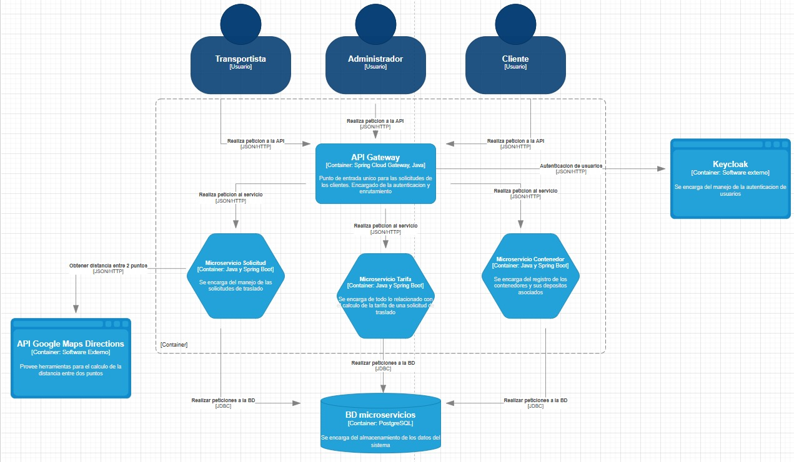

# Plataforma de Logística y Transporte de Cargas (Microservicios)

Sistema backend distribuido basado en arquitectura de **microservicios** para la gestión integral de solicitudes de transporte de contenedores, cálculo de rutas tentativas con distancias geográficas reales, gestión de depósitos/estadías, tarifas dinámicas y seguridad centralizada mediante OAuth2 / JWT.



---

## ¿Qué hace el sistema?

- **Enrutamiento y Seguridad Centralizada (`ms-apigateway`):** Punto único de entrada (Spring Cloud Gateway WebFlux) que valida tokens JWT emitidos por **Keycloak** y aplica control de acceso basado en roles (`ROLE_ADMIN`, `ROLE_OPERADOR`, `ROLE_CLIENTE`, `ROLE_TRANSPORTISTA`).
- **Gestión de Solicitudes y Rutas (`ms-solicitud`):** Alta y seguimiento de solicitudes de transporte, asignación de camiones verificando compatibilidad de peso/volumen, planificación de tramos y cálculo de distancias mediante **Google Maps Distance Matrix API**.
- **Gestión de Contenedores y Depósitos (`ms-contenedor`):** Administración de contenedores, depósitos intermedios y cálculo de costos diarios de estadía.
- **Motor de Tarifas y Costos (`ms-tarifa`):** Cálculo dinámico del costo total de transporte considerando combustible por kilómetro, cargo de gestión por tramo, costo base del camión y estadía en depósitos según tarifas vigentes.

---

## Arquitectura de Microservicios

| Servicio / Componente | Puerto | Responsabilidad Principal |
| :--- | :---: | :--- |
| **`ms-apigateway`** | `8080` | API Gateway reactivo, CORS, validación OAuth2/JWT y proxy hacia Swagger UI. |
| **`ms-solicitud`** | `8084` | Solicitudes, rutas tentativas, tramos, clientes, camiones y geolocalización (`GeoService`). |
| **`ms-contenedor`** | `8083` | Contenedores, estados y gestión de depósitos. |
| **`ms-tarifa`** | `8085` | Tarifas vigentes por rango de fechas, combustible y cargos por tramo. |
| **`keycloak`** | `8081` | Servidor de identidad OpenID Connect / OAuth2 con realm preconfigurado (`tpi-realm`). |
| **`postgres`** | `5432` | Base de datos relacional PostgreSQL 17 inicializada con esquema y datos de prueba. |

---

## Tecnologías Utilizadas

- **Lenguaje y Framework:** Java 21, Spring Boot 3.5.7
- **Microservicios & Cloud:** Spring Cloud Gateway (WebFlux), Spring RestClient, Spring Boot Actuator
- **Seguridad:** Keycloak 23.0, Spring Security, OAuth2 Resource Server (JWT / JOSE)
- **Persistencia:** PostgreSQL 17, Spring Data JPA / Hibernate
- **Integraciones y Documentación:** Google Maps Distance Matrix API, Springdoc OpenAPI / Swagger UI
- **Infraestructura:** Docker & Docker Compose, Maven

---

## Inicio Rápido con Docker

1. **Configurar variables de entorno:**
   ```powershell
   cp .env.example .env
   # Opcional: agregar tu GOOGLE_MAPS_API_KEY en .env para cálculo de distancias en vivo
   ```

2. **Levantar toda la plataforma:**
   ```powershell
   docker compose up --build
   ```

3. **Accesos principales:**
   - **API Gateway:** `http://localhost:8080`
   - **Keycloak Admin / Realm:** `http://localhost:8081`
   - **Swagger UI (vía Gateway):**
     - `http://localhost:8080/ms-solicitud/swagger-ui.html`
     - `http://localhost:8080/ms-contenedor/swagger-ui.html`
     - `http://localhost:8080/ms-tarifa/swagger-ui.html`
